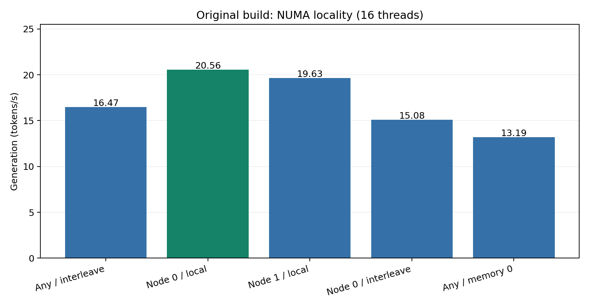
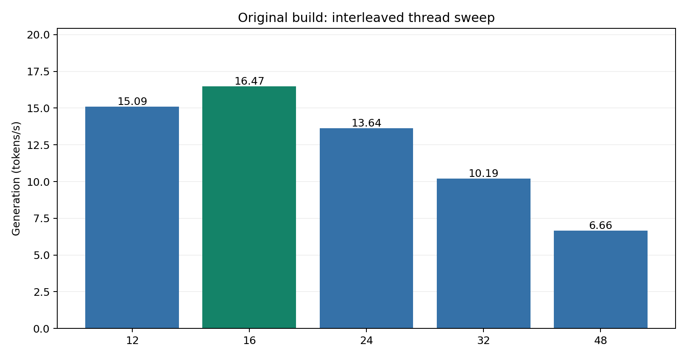
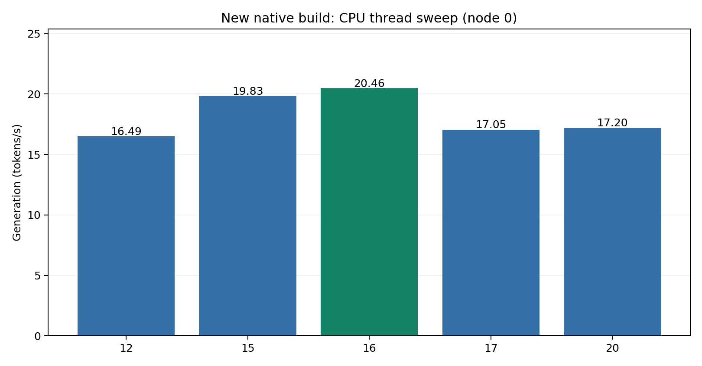
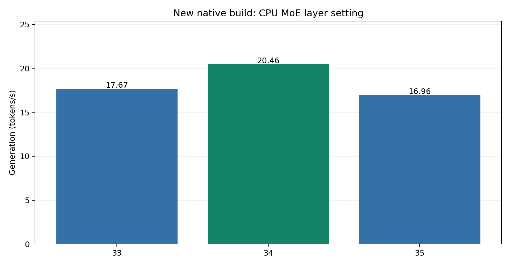
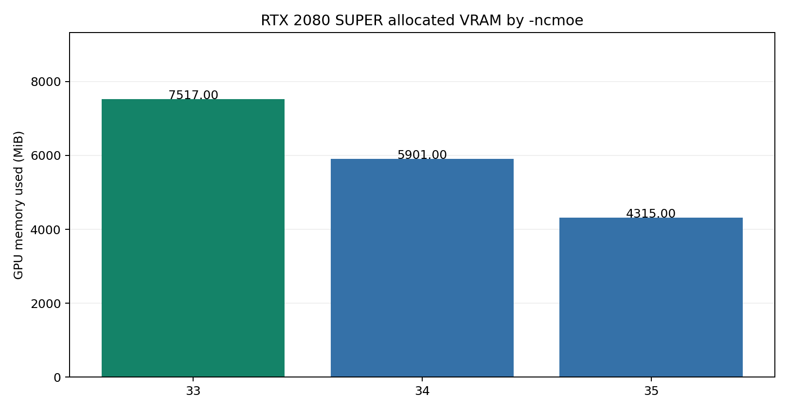

# Dell PowerEdge R740: GPT-OSS 120B Local LLM Benchmark & Tuning

> Can a refurbished 2U dual-Xeon server with **384 GB RAM** and an **8 GB RTX 2080 SUPER** run GPT-OSS 120B usefully? This community case study documents hands-on tuning of CPU affinity, NUMA memory locality, CPU threads, native recompilation, and MoE CPU/GPU placement.

**Test date:** October 25, 2026  
**Related earlier study:** [Dell R640 Local LLM Performance Comparison](https://github.com/medtech1/Local-LLM-Performance-Comparison---Dell-R640)

## TL;DR

- The best observed **original-build** result after the CPU upgrade was **20.56 tokens/s generated** and **167.94 tokens/s prompt processing**, with 16 llama.cpp threads, `--cpunodebind=0 --membind=0`, `-ncmoe 34`, and `-ngl 50`.
- The separate **new native Xeon 6252 build** reached **20.46 tokens/s generated**, effectively similar to the previous best within uncontrolled between-run variability; no performance gain from recompiling was demonstrated.
- Memory and execution placement mattered enormously: original-build 16-thread generation measured **20.56 t/s locally on NUMA node 0**, **19.63 on node 1**, **15.08 with node-0 CPU plus interleaved memory**, and **13.19 with unrestricted CPUs plus node-0 memory**.
- **More threads were not better:** on the original build, 16 threads generated **16.47 t/s** with interleaved memory vs. **6.66 t/s** at 48 threads. On the new native build, 16 NUMA-local threads generated **20.46 t/s** versus **17.05 at 17 threads**.
- MoE offloading had a sharp optimum within the tested range. On the new build, `-ncmoe 33`, `34`, `35` produced **17.67**, **20.46**, **16.96 t/s** respectively; VRAM use was **7,517**, **5,901**, **4,315 MiB** respectively.
- These are empirical observations for **one server, one model, one GPU and one benchmark script**—not universal recommendations or head-to-head CPU-only benchmarks.



## Hardware and software

| Component | Configuration |
| --- | --- |
| Server | Dell PowerEdge R740 |
| Upgraded CPUs | **2 × Intel Xeon Gold 6252**, 24 cores / 48 threads each; **48 cores / 96 logical CPUs total** |
| Previous R740 CPUs | **2 x Intel Xeon Gold 6134** 8 cores / 16 threads per CPU;  **16 cores/32 logical CPUs total** Base Freq 3.20GHz, Max Turbo Freq: 3.70 GHz| 
| System RAM | **384 GB installed ECC RAM**; Linux NUMA report: 191,944 MB on node 0 and 193,481 MB on node 1 (available node memory is not the same unit as installed capacity) |
| RAM channels / speed | DIMM slot/channel population and negotiated memory data rate **not yet verified** |
| NUMA | 2 nodes; Linux distances local 10 / remote 21 |
| GPU | NVIDIA GeForce RTX 2080 SUPER, **8 GiB VRAM**, PCI `0000:3B:00.0`, attached to NUMA node 0 |
| OS | Debian Linux (release not independently captured for this R740 session) |
| NVIDIA driver | 615.71.10 as reported by `nvidia-smi` |
| CUDA compiler | CUDA Toolkit **13.4.92** |
| llama.cpp | `0.7.0-dev`, build **11829**, commit `184f65360` |
| Model | `gpt-oss-120b-MXFP4.gguf` |
| BIOS power profile | Performance; Maximum Performance CPU power policy, Intel Turbo enabled, C-states disabled, uncore maximum |
| Linux CPU governor | `performance` on all 96 logical CPUs during testing; `intel_pstate` passive |

**Model size and full layer placement:** The GGUF byte size and full startup tensor-allocation log were not captured in the record; do not infer them from the model name or VRAM readings.

## Methodology and important limitations

Tests were made through a local **llama-server HTTP endpoint**, not the official standalone `llama-bench` program. The included [`scripts/llamabench2.py`](scripts/llamabench2.py) is the actual custom script used. It prints labels `pp512` and `tg128` but these are **approximations/targets**, not fully standardized benchmarks:

- Prompt test constructs the string `"word " * 390` plus a randomized ID; its exact token count was **not independently verified to be 512**. It requests **one generated token** and reads `timings.prompt_per_second`.
- Generation test uses the short fixed prompt *“Explain quantum computing in exactly one sentence.”* with `n_predict: 128`; it reads `timings.predicted_per_second`. The number actually generated is not checked, and `cache_prompt` is not disabled for this test. Treat possible prompt caching and early stops as caveats.
- Five iterations are run; the first is discarded from reported averages. A 16-token warmup runs before these iterations. One second separates iterations.
- The script labels `timings.prompt_ms` as **TTFT**, but that is **server-reported prompt evaluation time, not measured end-to-end time to first token**.
- Results were collected sequentially, often with a server restart per setting. Background activity, CPU frequency, GPU activity, KV cache state, scheduling and run-to-run variation were not completely controlled. The observed 16-thread local result varied between 19.24 and 20.56 t/s on the original binary; the new binary varied between 19.74 and 20.46 t/s.
- **Historical previous-CPU baseline** is an R740 pre-upgrade result as recorded in this session; it was not independently established as same-day identical conditions or the R640's benchmark. Do not interpret the comparison as pure CPU IPC uplift.
- All performance figures below are **tokens per second**, higher is better; charts are based on the four post-warmup averages for each reported run.

## 1. CPU upgrade and initial thread sweep

The pre-upgrade best cited R740 baseline was **157.23 prompt / 16.32 generation t/s** at 32 threads. After installing the two 6252s, using an interleaved NUMA allocation:

| Original build, new CPUs, interleaved | pp (t/s) | generation (t/s) |
| --- | ---: | ---: |
| 12 threads | 153.52 | 15.09 |
| 16 threads | 156.70 | 16.47 |
| 24 threads | 160.01 | 13.64 |
| 32 threads | 158.27 | 10.19 |
| 48 threads | 156.86 | 6.66 |



A large number of threads helped neither generation nor prompt throughput for this model/configuration. Core count is not a proxy for single-request generation throughput.

## 2. NUMA placement: the largest observed gain

All rows below use **16 inference threads**, original build and `-ncmoe 34`:

| CPU execution restriction | Memory placement | pp (t/s) | generation (t/s) |
| --- | --- | ---: | ---: |
| Unrestricted | Interleaved across both nodes | 156.70 | 16.47 |
| Node 0 | Node 0 only | 167.94 | **20.56** |
| Node 1 | Node 1 only | 159.38 | 19.63 |
| Node 0 | Interleaved across both | 169.04 | 15.08 |
| Unrestricted | Node 0 only | 155.39 | 13.19 |


The RTX 2080 SUPER is PCIe-local to **NUMA node 0** (`nvidia-smi topo -m`). However these comparisons do **not** isolate PCIe effects from CPU scheduling and CPU-memory locality. “Unrestricted CPU” also does not prove threads actually moved between sockets.

**Best original-build launch command:**

```bash
cd /opt/llama.cpp
numactl --cpunodebind=0 --membind=0 \
  ./build-cuda/bin/llama-server \
  -m models/gpt-oss-120b/gpt-oss-120b-MXFP4.gguf \
  --host 127.0.0.1 --port 8080 --load-mode none \
  -ncmoe 34 -ngl 50 -t 16 -c 4096
```

## 3. Fine-grained affinity and thread tests

On the **original build** with memory local to node 0:

| CPU affinity / threads | pp | generation |
| --- | ---: | ---: |
| Node 0 scheduler / 14 threads | 166.49 | 17.53 |
| Node 0 scheduler / 16 threads | 167.94 | **20.56** |
| Node 0 scheduler / 18 threads | 169.69 | 16.83 |
| Node 0 scheduler / 20 threads | 170.31 | 14.56 |
| 16 distinct physical cores, 16 threads | 167.70 | 17.63 |
| 24 distinct physical cores, 16 threads | 168.92 | 20.33 |

The 16-core process-wide affinity restriction was worse than allowing execution on 24 distinct cores. This **does not prove** Hyper-Threading helps; the restriction also leaves fewer cores available for auxiliary worker threads and the process generally. The 24-core, no-SMT-sibling test nearly matched the unrestricted node-0 result.

## 4. Native rebuild on the upgraded Xeons

The **original build was compiled before the CPU swap**, using `GGML_NATIVE=ON`. A second build directory was configured on the upgraded Xeons at the **same Git commit**:

```bash
cmake -S . -B build-cuda-6252 \
  -DCMAKE_BUILD_TYPE=Release \
  -DCMAKE_CUDA_COMPILER=/usr/local/cuda-13.4/bin/nvcc \
  -DCMAKE_CUDA_ARCHITECTURES=75 \
  -DGGML_CUDA=ON -DGGML_NATIVE=ON -DGGML_CPU_REPACK=ON \
  -DGGML_CUDA_FA=ON -DGGML_CUDA_GRAPHS=ON -DGGML_CUDA_NCCL=ON
cmake --build build-cuda-6252 --config Release -j 16
```

CMake selected `-march=native` and the new `libggml-cpu.so.0.27.0` visibly contained `vpdpwssd` (VNNI dot-product) instructions. The initial build's searched library yielded no VNNI matches. **Presence of an instruction does not establish how frequently the target inference kernel uses it.** `GGML_CUDA_NCCL=ON` was requested but CMake warned **NCCL not found**—not a blocker for this single-GPU run.

Using the **new build** with local CPU/memory node 0, `-ncmoe 34`:

| Threads | pp (t/s) | generation (t/s) |
| --- | ---: | ---: |
| 12 | 164.73 | 16.49 |
| 15 | 167.68 | 19.83 |
| 16 (first pass) | 167.08 | 19.74 |
| **16 (repeat)** | 167.15 | **20.46** |
| 17 | 167.66 | 17.05 |
| 20 | 170.81 | 17.20 |



**Takeaway:** Rebuilding is correct practice after replacing the CPUs if native tuning was used, but this benchmark did not demonstrate a measurable gain over the old build. Both reached ~20.5 t/s under favorable conditions. The unexpectedly steep fall at 17 threads is reproducible *within that five-iteration run*, but the underlying cause (work splitting, synchronization, affinity, other) was **not diagnosed**.

**New native build launch command:**

```bash
cd /opt/llama.cpp
numactl --cpunodebind=0 --membind=0 \
  ./build-cuda-6252/bin/llama-server \
  -m models/gpt-oss-120b/gpt-oss-120b-MXFP4.gguf \
  --host 127.0.0.1 --port 8080 --load-mode none \
  -ncmoe 34 -ngl 50 -t 16 -c 4096
```

## 5. MoE CPU/GPU placement and VRAM tradeoffs

With 16 inference threads, local node 0 CPU/memory and the **new build**:

| `-ncmoe` | pp (t/s) | generation (t/s) | total GPU memory used (MiB) |
| ---: | ---: | ---: | ---: |
| 33 | **171.89** | 17.67 | 7,517 |
| **34** | 167.15 | **20.46** | 5,901 |
| 35 | 164.93 | 16.96 | 4,315 |




GPU memory includes the model, buffers, other allocations and any graphics usage seen in `nvidia-smi`. Changing one `-ncmoe` step changed observed allocation by about **1.6 GiB**. On this RTX 2080 SUPER, **more GPU allocation did not monotonically improve generation speed**. With `-ncmoe 33`, only ~675 MiB was free; further reduction would have risked memory exhaustion. Don't extrapolate this optimum to GPUs with different memory sizes or architectures.

## 6. CPU clocks, thermals, package power

The BIOS System Profile was Performance; Intel Turbo Boost was enabled and the Linux CPU governor was switched to `performance` on all 96 logical CPUs. `intel_pstate` reported `passive`.

- Sampled node-0 busy clocks in the **~2.42–2.69 GHz** range, over the 2.10 GHz base frequency. The published single-core maximum turbo figure is **3.70 GHz**, not an all-core guarantee.
- Sampled CPU 0 package temperatures around **44–47°C**, with `CoreThr` **0** in the throttling-counter snapshot. CPU 1 was mostly idle (~41–42°C package).
- Sampled CPU 0 package power **~87–114 W** in screenshots/output; configured package limits were **PL1 150 W**, **PL2 180 W**, PL4 **205 W locked**.
- These measurements provide **no indication of thermal throttling in the sampled windows**; they are not proof that power/AVX/frequency limits were never active during the whole workload. Neither RAPL package power nor combined CPU package power equals total server wall consumption.
- Raising power limits or overriding CPU frequency limits was **not tested**.

## 7. Reproducing a run

After confirming the official code/source revision, the model file, local security posture and available VRAM:

```bash
# Confirm the intended server is listening, and distinguish old/new binaries
pgrep -af llama-server
# Check current NUMA and GPU affinity
numactl --hardware
nvidia-smi topo -m
# Check local service only; do not expose unauthenticated inference on a public interface
cd /opt/llama.cpp
python3 scripts/llamabench2.py
```

Copy `scripts/llamabench2.py` to the llama.cpp working directory, or run it from the repository folder; it only needs Python `requests` and an already started server on `127.0.0.1:8080`.

**Security:** This report documents observed settings; it is **not** a recommendation to run unverified model weights or scripts. Verify downloaded code/model provenance and hashes independently, avoid remote install pipes, and use localhost binding unless deliberately deploying a secured service.

## What remains unanswered

- Memory DIMM placement, DRAM speed, and physical memory bandwidth under this R740 configuration.
- A standardized official `llama-bench` rerun with verified exact token counts, all repeats, stable cache behavior and fuller run metadata.
- Why 16 threads was unusually fast relative to 17–20 threads.
- Exact allocation details from model-load logs and compute/memory transfer profiling.
- Multi-GPU V100 testing: **planned, not included** in this report; no projected performance figures treated as measurements.

## Credits and related project

This is an independently run community hardware investigation: real output from a Dell R740, collected and discussed iteratively with ChatGPT. It is intended to help others evaluate refurbished enterprise hardware for local AI. Feedback, independent reproductions, corrections and additional measurements are welcome.

For the earlier R640 CPU/8B/32B case study, see [the companion repository](https://github.com/medtech1/Local-LLM-Performance-Comparison---Dell-R640). The R640 measurements use **different models, quantizations and methods**; they should **not** be compared numerically to these R740 GPT-OSS 120B hybrid GPU results.
